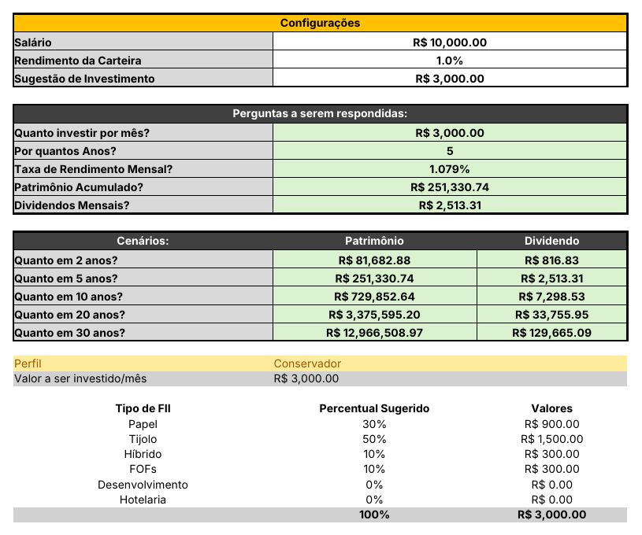
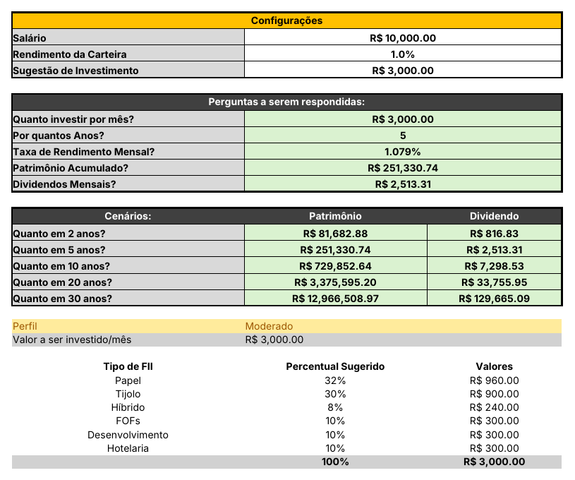

# simulador-investimento-fii

Simulador de investimento em **fundos imobiliários (FIIs)** feito em Excel: a partir do aporte mensal, do prazo e da taxa de rendimento, calcula o patrimônio acumulado, os dividendos mensais, projeta cenários de 2 a 30 anos e divide o aporte entre seis tipos de FII conforme o perfil de investidor escolhido numa lista.

> Projeto do desafio da DIO (Felipe Aguiar). Salário e valores da planilha são **exemplos**, não dados reais. Os percentuais por perfil são ilustrativos e **não são recomendação de investimento**.

**Arquivo:** [`simulador-investimento-fii.xlsx`](simulador-investimento-fii.xlsx) (abas `Perguntas` e `Suporte`)

## 1. Perguntas que a ferramenta responde

| Pergunta | Onde aparece (aba `Perguntas`) |
|---|---|
| Quanto investir por mês? | `C8` (entrada) — sugestão de 30% do salário em `C5` |
| Por quantos anos? | `C9` (entrada) |
| Qual a taxa de rendimento mensal? | `C10` (entrada) |
| Quanto de patrimônio vai acumular? | `C11` |
| Quanto vai receber de dividendos por mês? | `C12` |

Extras: cenários de 2, 5, 10, 20 e 30 anos em `B15:D19` e divisão do aporte por tipo de FII em `B24:D31`.

## 2. Como VF e PROCV entram nos cálculos

**VF (`FV`)** — patrimônio acumulado com aportes mensais constantes:

```excel
=FV(TX_Mensal, Quantidade_Anos*12, Aporte*-1)
```

- `TX_Mensal`: taxa por período (mês); `Quantidade_Anos*12`: número de períodos em meses; `Aporte*-1`: pagamento por período, negativo para o resultado vir positivo.
- Dividendos mensais: `=C11*Rendimento_Carteira`.
- Os cenários repetem a fórmula trocando só o prazo (`2*12`, `5*12`...), sempre com os intervalos nomeados.

**PROCV (`VLOOKUP`) com chave composta** — cada perfil tem 6 linhas na aba `Suporte`, e o nome do perfil sozinho não é único. A coluna `A` concatena `Perfil-Tipo` (ex.: `Moderado-Tijolo`), e a aba `Perguntas` monta a mesma chave:

```excel
=VLOOKUP($C$21&"-"&B25, Suporte!$A$3:$D$20, 4, FALSE)
```

Ao trocar o perfil em `C21` (lista suspensa), os percentuais e os valores em R$ (`D25:D30 = aporte × percentual`) são recalculados. `C31` confere se a soma é 100%.

## 3. Intervalos nomeados

| Nome | Célula | Uso |
|---|---|---|
| `Aporte` | `Perguntas!C8` | aporte mensal |
| `Quantidade_Anos` | `Perguntas!C9` | prazo em anos |
| `TX_Mensal` | `Perguntas!C10` | taxa de rendimento mensal |
| `Rendimento_Carteira` | `Perguntas!C4` | rendimento usado para estimar dividendos |

## 4. Percentuais de cada perfil

Valores ilustrativos definidos por mim; cada perfil soma 100%. *(inspirados no exemplo da aula)*

| Tipo de FII | Conservador | Moderado | Agressivo |
|---|---|---|---|
| Papel | 30% | 32% | 50% |
| Tijolo | 50% | 30% | 10% |
| Híbrido | 10% | 8% | 5% |
| FOFs | 10% | 10% | 5% |
| Desenvolvimento | 0% | 10% | 20% |
| Hotelaria | 0% | 10% | 10% |

## 5. O que mudei em relação à ferramenta do Expert

*(Preencha com o que for seu — exemplos do que o arquivo contém:)*
- Coluna de conferência da soma dos percentuais (`C31`).
- Cenários com patrimônio **e** dividendo lado a lado.
- Intervalos nomeados também nas fórmulas de cenário.

## Evidência: mesma simulação, perfis diferentes

Aporte de R$ 3.000/mês, 5 anos, 1,079% a.m. → patrimônio de R$ 251.330,74 e dividendos de R$ 2.513,31/mês em todos os perfis. Só a divisão do aporte muda:

| Conservador | Moderado | Agressivo |
|---|---|---|
|  |  |  |
